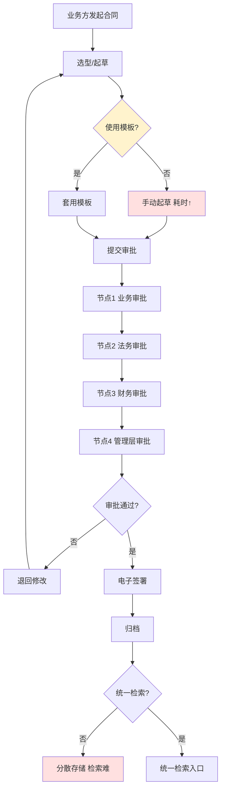

# ⑤ 现状流程图（Current State Flow）

> 阶段：opportunity ｜ 交付格式：.md（Mermaid）｜ 模板/示例

下图使用 Mermaid 描述合同业务**现状**流程，可在 GitHub 或支持 Mermaid 的
编辑器中直接渲染。

## 流程解读

- **串行审批**（G→H→I→J）是耗时主因，对应假设 H1。
- **模板使用不稳定**（C 分支）导致起草效率波动，对应 H2。
- **归档后检索困难**（O→P）影响客户体验，对应 Q3。

## 改进方向（机会点）

1. 审批并行化 + 自动初审，压缩 G–J 时长。
2. 建立中央模板库，提升 C 分支「是」的比例。
3. 统一归档与检索入口，消除 P 节点。
